

# 🌊 Spotify Arc

*“Spotify playlists are flat lists, but human energy isn't.”*

The dynamic energy curve & time-architected playlist engine for Spotify.  
Built for **Hack to the Future 2026** 🏆

  

<a href="https://shaunjee.github.io/SpotifyArc/">
  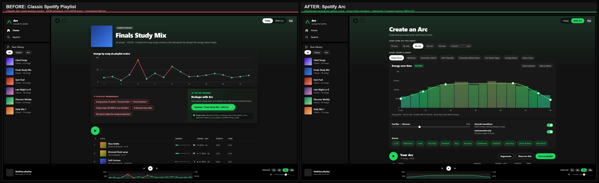
</a>

  

🌐 **Demo Website:** [https://shaunjee.github.io/SpotifyArc/](https://shaunjee.github.io/SpotifyArc/)  
👉 *Click the link or poster above to launch the live demo website with zero setup!*

---

## 🎬 3-Minute Demo Video Walkthrough

Watch the complete **3-minute walkthrough** demonstrating Spotify Arc in action—from instant playlist weakness diagnostics and 1-click fixed-pool Reshape mode to live Fritsch–Carlson cubic spline editing, procedural Web Audio synthesis, and beat-matched DJ crossfades:

▶ **[Click here to watch or download demo_video.mp4 (Full 1080p 60fps)](demo_video.mp4)**

> *The demo video is committed directly to the repository root as [`demo_video.mp4`](demo_video.mp4).*

---

## 🌟 Quick Links for Judges

- 🔄 [**Compare Classic Playlists vs. Arc (`#today`)**](https://shaunjee.github.io/SpotifyArc/#today) — Inspect real playlist weaknesses (40+ point energy spikes, BPM whiplash, dissonant key shifts) and click **Reshape with Arc ✨**.
- ⚡ [**Arc Interactive Builder (`#arc`)**](https://shaunjee.github.io/SpotifyArc/#arc) — Draw custom energy curves, test presets (**Pomodoro 50/10**, **HIIT Intervals**), and watch the beam-search solver re-flow tracks in <80ms.
- 🔍 [**Catalog Search & Pinning (`#search`)**](https://shaunjee.github.io/SpotifyArc/#search) — Browse all 248 procedural tracks across 12 genres, open the **Track DNA** inspector, and preview Web Audio synth models.
- 🔗 [**Shared Arc Template: Finals Week 90**](https://shaunjee.github.io/SpotifyArc/#arc=90:1:0,25_15,45_30,65_75,68_92,40_100,22) — A 90-minute instrumental focus session reconstructed dynamically from a compressed URL hash.

---

## 💥 The Problem

Spotify playlists are flat, unordered lists—but human energy is biological and time-bound:
- A **90-minute study session** needs a calm ramp-up, a long sustained focus plateau, and a gentle landing.
- A **45-minute HIIT workout** needs warm-ups, explosive peak intervals, and deliberate recovery dips.

Even with Spotify's recent *Mix* and *Smart Reorder* features, listeners still suffer through:
1. **Energy Whiplash**: Jumps from low-energy lo-fi (20 energy) directly into high-octane dance pop (90 energy) in a single shuffle.
2. **Tempo & Harmonic Clashes**: Uncurated transitions across disparate BPMs and clashing Camelot keys.
3. **Time Mismatch**: Playlists are either 3 hours too long or 20 minutes too short—forcing listeners to constantly monitor the clock and skip tracks manually.

---

## 📊 Before & After: How Spotify Works Today vs. With Arc

| Dimension | Today (Classic Playlists & Mix) | With Spotify Arc |
|---|---|---|
| **Energy Structure** | **Chaotic & Flat:** Tracks play in added or random shuffle order, causing abrupt 40+ point energy jumps. | **Intentional Macro-Architecture:** Continuous 2D energy spline curve with monotone cubic interpolation over an exact time block. |
| **Duration Precision** | **Arbitrary Length:** Playlists ignore your schedule; you have to watch the clock and stop manually. | **Exact Time Fit (±15s):** Combinatorial beam-search solver guarantees total track duration lands within 15 seconds of target. |
| **Existing Library** | **Start Over:** Users must abandon existing playlists to try new algorithm mixes. | **1-Click Reshape Mode:** Re-orders 100% of an existing playlist's fixed song pool into a smooth curve without adding or removing a track. |
| **Algorithmic Explainability** | **Black Box:** Recommendation algorithms offer zero explanation for track ordering. | **Explainable AI Tooltips:** Hovering `ⓘ` reveals exact transition math (energy vs target, BPM distance, Camelot harmonic compatibility). |
| **Mid-Session Adaptation** | **Static:** If your pacing changes mid-workout, you have to stop and search for new music. | **Live Re-flow:** Tap **Ease off** or **Push harder** while playing; remaining tracks dynamically re-solve in real time. |
| **Audio Transitions** | **Basic Crossfade:** Linear volume ducking regardless of tempo or bar timing. | **Beat-Matched DJ Crossfade:** Bar-aligned 4-second equal-power cosine/sine crossfades with dynamic tempo ramping. |

---

## 🚀 Interactive Walkthrough (Step-by-Step)

The live demo runs 100% in-browser with zero build tools or servers needed:

1. **Inspect Classic Playlist Weaknesses (`#today`):**
   - Click **Finals Study Mix** on Home or in the left sidebar.
   - Inspect the red warning spikes on the **Energy by song** chart (e.g., 77-point energy leap, 103 BPM jump).
   - Click **Reshape with Arc ✨** to watch the 18 tracks FLIP-reorder smoothly along a calibrated focus arc.
2. **Design an Arc from Scratch (`#arc`):**
   - Select a target duration (`25m`, `45m`, `60m`, `90m`, `120m`, or custom).
   - Choose a preset: **Deep Focus**, **Workout**, **Pomodoro 50/10**, **HIIT Intervals**, **Sunday Reset**, etc.
   - Drag control points on the canvas: notice the white tooltip pill and the dashed white ghost curve showing previous vs. current shape.
   - Toggle **Draw freehand** to sketch a custom multi-wave curve with your cursor, or toggle **Edit as sliders** for 6-interval accessible range controls.
3. **Lock & Swap Anchor Songs:**
   - Click the green **Lock** icon (`🔒`) on any track to pin it to its slot.
   - White caps appear on top of locked bars in the curve chart, and the header displays `🔒 X pinned`.
   - The footer confirms target precision: `59:54 of 1:00:00 ✓`.
4. **Inspect Algorithmic Explainability:**
   - Hover over the `ⓘ` button on any track row.
   - Read the explainability tooltip: *“Why this song? Energy 47 vs target 48 · 13 BPM from previous · Key 8A→7A (harmonic)”* next to the colored Camelot harmonic dot (`●`).
5. **Audition Track DNA & Procedural Synthesis:**
   - Click **Search** in the sidebar to explore 248 tracks across 12 genres.
   - Click any song to open the **Track DNA Inspector Modal**.
   - Click **Preview Song** to hear the isolated 30s Web Audio synthesizer (Rhodes piano, jazz horn, ambient bells, or breakbeats) with animated equalizer bars.
6. **Experience Beat-Matched Playback & Live Adaptation:**
   - Press **Play** and toggle **12× Preview** speed to audition transitions quickly.
   - Watch the glowing green **🔀 Crossfade HUD pill** display live BPM ramping and harmonic key compatibility.
   - Tap **Push harder** on the bottom-right pill: watch the second half of the curve lift and high-energy tracks flow in immediately.

---

## 📸 Curated Screenshot Gallery

| 01 · Hero Split (Before vs. After) | 02 · Home Screen Discovery | 03 · Playlist Weakness Diagnostics |
|:---:|:---:|:---:|
|  | [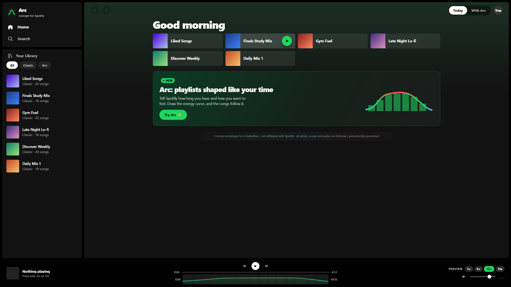](screenshots/02-home-screen-discovery.png) | [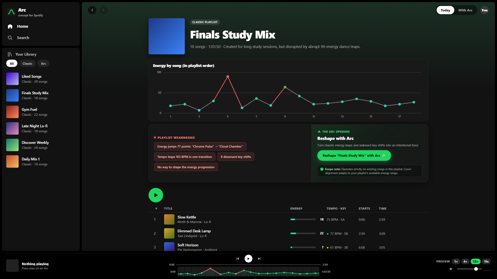](screenshots/03-classic-playlist-diagnostics.png) |
| **04 · Fixed-Pool Reshape Mode** | **05 · Arc Builder Workspace** | **06 · Spline Dragging & Ghost Curve** |
| [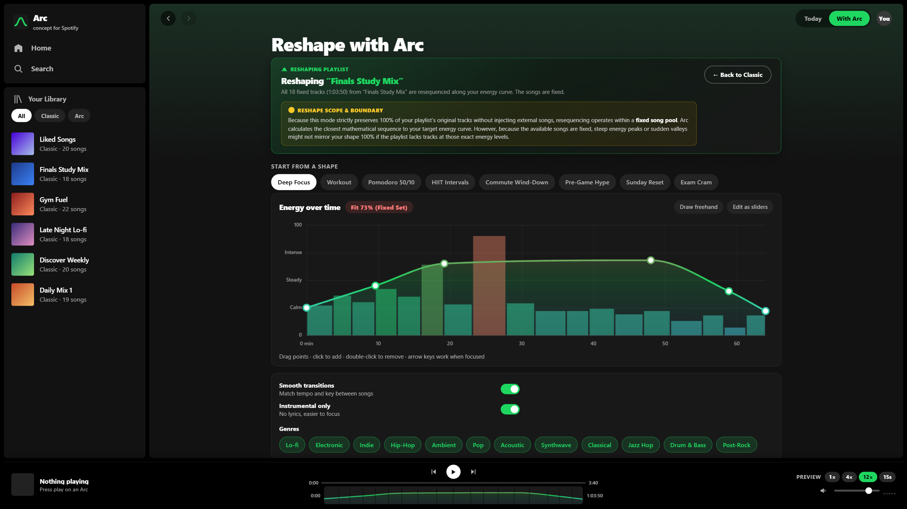](screenshots/04-reshape-fixed-pool-mode.png) |  | [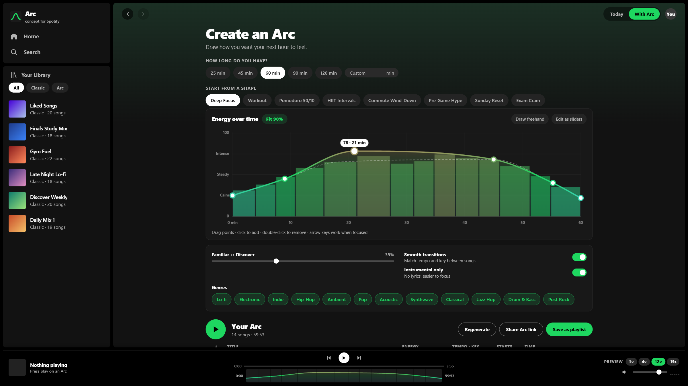](screenshots/06-curve-dragging-ghost-curve.png) |
| **07 · Freehand Sketch Mode** | **08 · Accessible Sliders Mode** | **09 · Explainable AI Tooltip** |
| [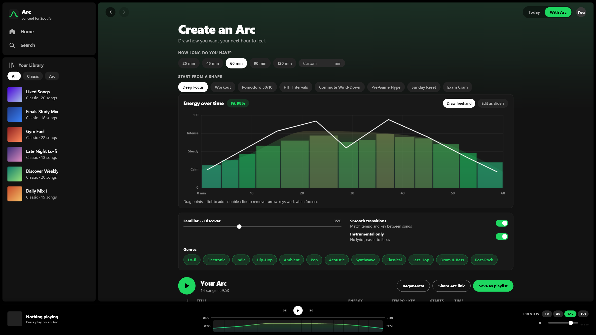](screenshots/07-freehand-sketch-mode.png) | [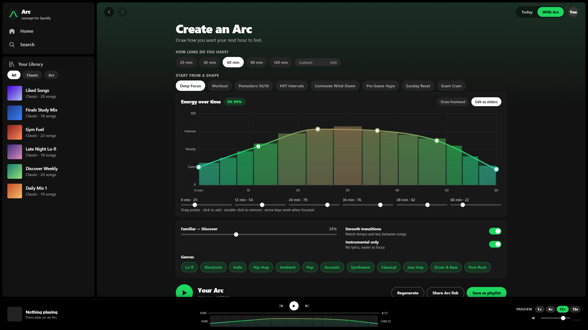](screenshots/08-edit-as-sliders-mode.png) | [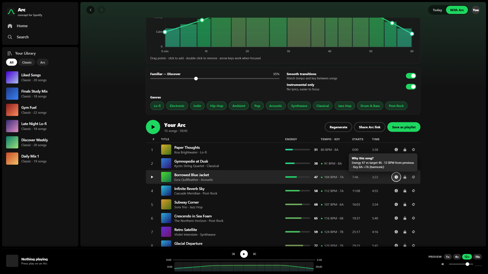](screenshots/09-explainable-ai-why-this-song.png) |
| **10 · Track Locking & Precision** | **11 · Catalog Search & Pinned Filter** | **12 · Track DNA Inspector Modal** |
| [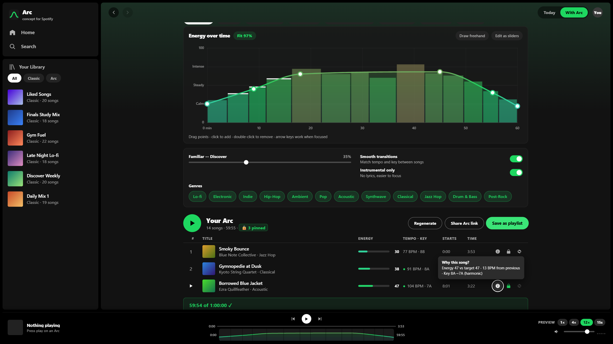](screenshots/10-track-locking-duration-precision.png) | [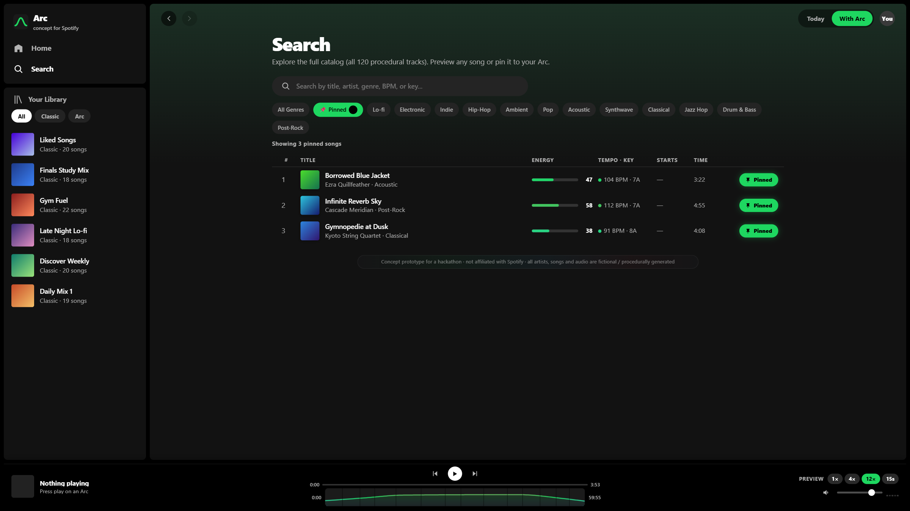](screenshots/11-catalog-search-pinned-filter.png) | [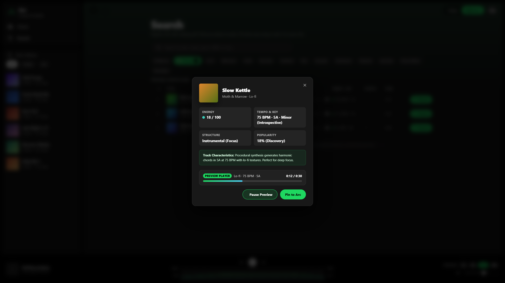](screenshots/12-track-dna-inspector-modal.png) |
| **13 · Live Crossfade HUD Player** | **14 · Mid-Session Push Harder** | **15 · Saved Arcs & Filter Warning** |
| [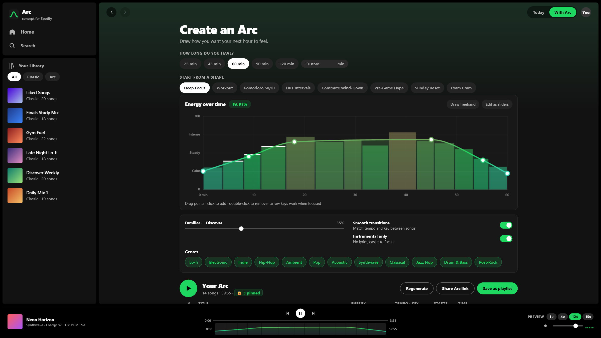](screenshots/13-live-crossfade-hud-player.png) | [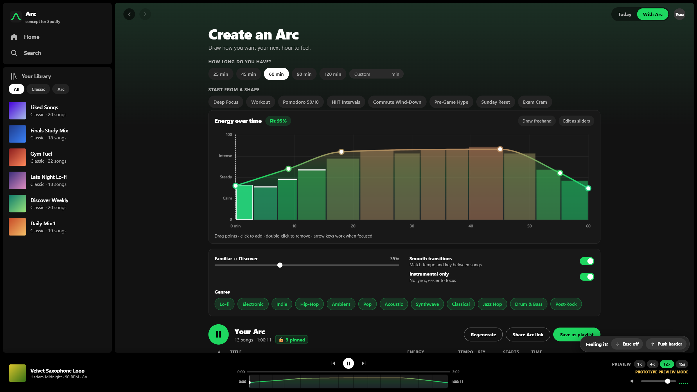](screenshots/14-mid-session-adaptation-push-harder.png) | [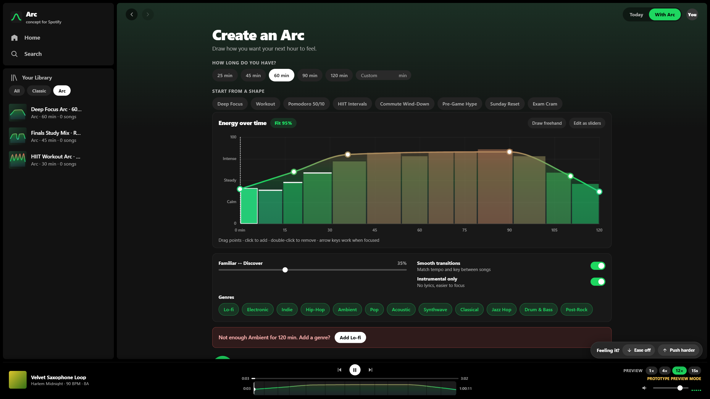](screenshots/15-saved-arcs-library-filter-warning.png) |

---

## 🧠 Technical Architecture & Engineering

### 1. Dual-Mode Sequencer (Constraint-Satisfaction Beam Search)
- **Catalog Mode:** Generates a fresh Arc matching duration $D \pm 15s$. Evaluates candidate tracks via $O(1)$ prefix-sum integrals of the spline curve (`makeTarget` / `meanT`). Combines slot energy cost with transition penalties: BPM distance (with half/double-time weighting), Camelot harmonic circle distance, and genre affinity.
- **Fixed-Pool Reshape Mode:** Runs a permutation beam search ($W = 36$) over 100% of an existing playlist's tracks. Resequences the user's exact collection without adding or dropping songs.

### 2. Spline Physics & Freehand Simplification
- **Fritsch–Carlson Monotone Cubic Spline:** Guarantees monotonicity between control points, eliminating runaway overshoots past `[0, 100]` energy boundaries.
- **Ramer–Douglas–Peucker Algorithm:** Simplifies freehand mouse/touch gestures into concise control points in real time.

### 3. In-Browser Web Audio Synthesizer
- Built to circumvent Spotify's deprecation of 30-second preview endpoints for new apps.
- Synthesizes 12 genres live using deterministic pseudo-random seeds (`mulberry32` + FNV-1a hashing):
  - **Felt Piano**: Multi-oscillator synthesis with acoustic body resonance.
  - **FM Rhodes & Jazz Horn**: Frequency-modulated electric keys and brass envelopes.
  - **Amen Breakbeats**: Granular drum synthesis with syncopated velocity patterns.
  - **Ambient Bell Chimes**: Long-decay sine/triangle FM bell algorithms.
- **Bar-Aligned Equal-Power Crossfading:** Schedules 4-second cosine/sine transitions on musical bar boundaries with continuous tempo interpolation.

---

## 🚀 How Spotify Could Roll This Out

Spotify already captures and stores per-track energy, tempo, Camelot key, and valence internally—and recently exposed tempo and key pills in **Spotify Mix**. 

**Spotify Arc** provides the missing macro-layer:
1. **Phase 1 (Premium Feature):** Launch **"Create an Arc"** in the mobile/desktop create flow and add **"Reshape with Arc ✨"** to existing playlist header menus.
2. **Phase 2 (Social & Creator Economy):** Enable public **Arc Templates** (e.g., Nike Marathon 4-Hour Pacer, Pomodoro 50/10 Study Arc) shareable via compact Spotify URLs or QR codes.
3. **Phase 3 (Wearable / Biometric Integration):** Connect Arc to Apple Watch / Garmin heart rate sensors to dynamically trigger **Ease off** or **Push harder** when workout intensity drifts from the target curve.

---

## 📜 Disclaimer & License

- **License:** Distributed under the [MIT License](LICENSE).
- **Disclaimer:** Concept prototype created for the **Hack to the Future 2026** hackathon. Not officially affiliated with or endorsed by Spotify AB. All artists, track names, cover art, and audio are procedurally generated in the browser.

---

## 👤 Author

**Shaun Jee Lim Jiet**  
- **GitHub:** [@ShaunJee](https://github.com/ShaunJee)  
- **Email:** shaunjee33@gmail.com  
- **Project Repo:** [https://github.com/ShaunJee/SpotifyArc](https://github.com/ShaunJee/SpotifyArc)  
- **Live Demo:** [https://shaunjee.github.io/SpotifyArc/](https://shaunjee.github.io/SpotifyArc/)