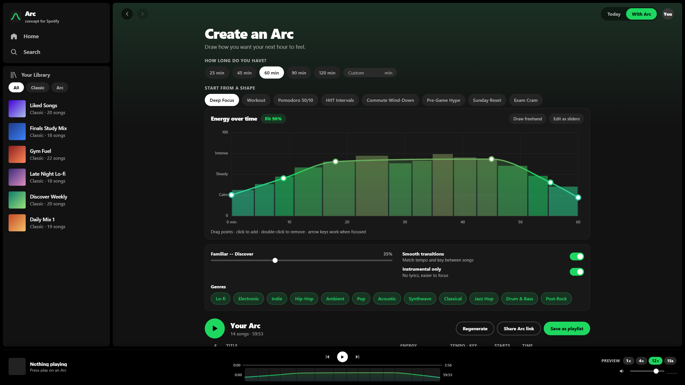

# Spotify Arc

Concept prototype for the **Hack to the Future** hackathon.  
**Project Name:** Spotify Arc · **App Upgraded:** Spotify  
*Playlists that follow the shape of your time.*

Live demo: `<GitHub Pages URL>`  |  Demo video: `<YouTube/Loom URL>`

> **Quick links for judges:**
> - 🔄 [**Compare Classic Playlists vs. Arc (`#today`)**](#today) — inspect real playlist weaknesses (40+ point energy spikes, BPM whiplash, dissonant key shifts) and click **Reshape with Arc ✨**.
> - ⚡ [**Arc Interactive Builder (`#arc`)**](#arc) — draw a custom energy curve, test interval presets (`Pomodoro 50/10`, `HIIT Intervals`), and watch the beam-search solver re-flow tracks in real time.
> - 🔍 [**Catalog Search & Pinning (`#search`)**](#search) — filter all 248 procedural tracks across 12 genres, open the **Track DNA** inspector, or pin anchor songs directly into your Arc.
> - 🔗 [**Shared Arc Template: Finals Week 90 (`#arc=90:1:0,25_15,45_30,65_75,68_92,40_100,22`)**](#arc=90:1:0,25_15,45_30,65_75,68_92,40_100,22) — a 90-minute instrumental focus session reconstructed dynamically from the URL hash.

---

## The Problem (2–3 Sentences)

Spotify playlists are flat lists, but the way we use music is not: a 90-minute study block needs a calm ramp-up, a long focused plateau, and a gentle landing, while a workout needs warm-up, peak intervals, and cool-down. Even with Spotify's recent *Mix* and *Smart Reorder* features, listeners still have to hand-pick songs, suffer through jarring energy spikes or tempo whiplash, and settle for playlists whose length never matches their actual time block. This affects every student, runner, commuter, and remote worker who relies on music to regulate focus, pacing, or effort.

---

## Before & After: How Spotify Works Today vs. With Arc

| Today (Classic Playlists & Mix) | With Spotify Arc |
|---|---|
|  |  |
| **Flat order & chaotic energy:** Songs play in the order they were added (`Liked Songs`, `Finals Study Mix`, `Gym Fuel`), causing jarring 40+ point energy leaps and 70+ BPM whiplash. | **Intentional energy architecture:** Draw a 2D energy curve over an exact target duration (`25m` to `120m` ±15s), or use multi-wave presets like **Pomodoro 50/10** and **HIIT Intervals**. |
| **Micro-transitions only:** Features like Spotify *Mix* crossfade adjacent tracks (`BPM` / `Key`), but cannot pick songs for you, target a 60-minute clock, or shape a macro-trajectory. | **Create New or Reshape Existing:** Build a fresh time-boxed Arc from the catalog, or click **Reshape with Arc ✨** on any existing playlist to resequence its exact songs along your curve. |
| **Static once started:** If you lose focus or want to push harder mid-run, you have to abandon the playlist and search for something else. | **Live mid-session adaptation:** Tap **Ease off** or **Push harder** while listening to dynamically re-solve upcoming tracks and shift energy on the fly. |

---

## Try It (Interactive Walkthrough)

Open `index.html` in Chrome, Edge, Safari, or Firefox (zero build steps, no server required, works 100% offline), or use the Live Demo link above.

1. **Inspect a Classic Playlist & Reshape It (`Today` view):**
   - Click any playlist on **Home** or under **Your Library → Classic** (e.g., *Liked Songs*, *Finals Study Mix*, *Gym Fuel*).
   - View the red **Playlist Weaknesses** diagnostics and the jagged energy chart.
   - Click **Reshape with Arc ✨** to resequence 100% of that playlist's existing songs into a smooth energy trajectory without adding or removing a single track.
2. **Build a Custom Time-Boxed Arc (`With Arc` view):**
   - Click **Try Arc ✨** on Home or toggle **With Arc** in the top bar.
   - Choose a duration (`25`, `45`, `60`, `90`, `120 min`, or `Custom`) and a starting shape (**Deep Focus**, **Workout**, **Pomodoro 50/10**, **HIIT Intervals**, **Commute Wind-Down**, **Pre-Game Hype**, **Sunday Reset**, **Exam Cram**).
   - Drag control points on the spline curve, toggle **Draw freehand**, or switch to **Edit as sliders**. Watch the **Fit %** badge and total duration (`60:02 of 60:00 ✓`) update in under 100ms.
3. **Search, Inspect Track DNA & Pin Anchor Songs:**
   - Open **Search** in the left sidebar to browse all **248 procedural tracks** across **12 genres**.
   - Click any song's title or cover art to open the **Track DNA Modal**, featuring harmonic key analysis, placement math, and an isolated **30-second Preview Player** with animated equalizer bars.
   - Click **Pin to Arc** (`📌`) on any track to lock it into your Arc at its mathematically optimal energy slot.
4. **Experience Beat-Matched Playback & Dual Progress Sliders:**
   - Press **Play**. The player bar features **two synchronized scrubbers**: a **Current Song Slider** and the **Arc Wavelength Bar** showing the full session's energy contour.
   - Use the **Preview Speed** toggle (`1×`, `4×`, `12×`, or `15s` excerpts) to hear a 60-minute Arc—complete with live **Crossfade HUD pills** (`🔀 Crossfade: 132 → 135 BPM · Key 9B → 10B (compatible)`)—in just a few minutes.
5. **Adapt Live, Save & Share:**
   - While playing an Arc, click **Ease off** or **Push harder** in the floating pill to shift the curve from your current playhead onward.
   - Click **Save as playlist** to generate custom curve cover art in **Your Library → Arc**, or click **Share Arc link** to copy a compressed URL hash of your template.

### Keyboard Shortcuts & Self-Test
- **Global:** `Space` play/pause · `←` / `→` previous/next song (or scrub ±5s when focused on the song slider) · `L` lock/pin selected row · `R` regenerate unlocked tracks · `Esc` close modals/tooltips.
- **Curve Editor (when focused):** `[` and `]` select control points · `Arrow keys` nudge point (`Shift` for larger steps) · `Delete` / `Backspace` remove point.
- **Diagnostics:** Run `__selfTest()` in the browser console to benchmark the beam-search sequencer across presets and durations (`25m`, `60m`, `90m`, `120m`).
- *Recording tip:* Keep the browser tab in the foreground while recording audio; background tabs throttle Web Audio timers.

---

## How It Works

- **Dual-Mode Sequencer (Constraint-Satisfaction Beam Search):**
  - **Catalog Generation Mode:** A time-bucketed beam search (`generate`) selects an ordered sequence of tracks summing to target duration `D ± 15s`. Prefix-sum lookups (`makeTarget` / `meanT`) evaluate mean target energy over any track's time slot in $O(1)$ time. Slot cost combines energy delta and Familiarity/Discovery preference; transition cost (`transCost`) penalizes BPM jumps (accounting for half/double-time), Camelot wheel harmonic distance (`camDist`), genre switches, and same-artist clustering. Pinned/locked tracks are anchored to their optimal energy slots.
  - **Fixed-Pool Reshape Mode:** When reshaping an existing playlist (`sequenceReshape`), a permutation beam search (`W = 36`) reorders 100% of the playlist's fixed track pool to minimize energy error and harmonic/tempo friction without injecting external tracks.
- **Monotone Cubic Spline & Freehand Editor:**
  - Uses Fritsch–Carlson monotone cubic interpolation (`makeSpline`) so user curves never overshoot `[0, 100]` energy bounds. Freehand strokes are simplified via the Ramer–Douglas–Peucker (`rdp`) algorithm. Also includes an accessible 6-band slider mode and a collaborative **Arc Blend** mode (`window.__arc.openBlendMode()`).
- **Procedural Web Audio Synthesizer:**
  - Every track is synthesized live in the browser via the Web Audio API (`Engine`) using deterministic seeding (`mulberry32` + FNV-1a `hashStr` of track ID, title, and artist).
  - Features genre-specific chord progressions (`STYLE_PROGS`), 7th/9th voicings, 32-step melodic contours, and dedicated custom instruments: multi-oscillator **Felt Piano** (Classical), **FM Rhodes & Jazz Horn** (Lo-fi / Jazz Hop), **FM Bell Chimes** (Ambient / Post-Rock), **Acoustic Guitar Plucks** (Acoustic / Indie), **Syncopated Amen Breakbeats** (Drum & Bass), sidechained saw pads, waveshaper bass distortion, and vinyl crackle/rain noise layers.
  - A look-ahead scheduler (`25ms` tick, `120ms` lookahead) aligns track switches on bar boundaries with **4-second equal-power cosine/sine crossfades** and live tempo ramping.
- **Self-Contained 248-Track Catalog:**
  - Combines 120 curated tracks with a deterministic procedural expansion pass (`248 total tracks` across **12 genres**: *Lo-fi, Electronic, Indie, Hip-Hop, Ambient, Pop, Acoustic, Synthwave, Classical, Jazz Hop, Drum & Bass, Post-Rock*). Because Spotify's public Web API deprecated audio-feature and 30-second preview endpoints for new developer apps, this self-contained architecture guarantees zero broken endpoints or rate limits.
- **Tools, Languages & AI Models Used:**
  - **Stack:** HTML5, CSS3, Vanilla JavaScript (ES6+), HTML5 Canvas 2D, Web Audio API, `localStorage`. Zero external runtime dependencies, no frameworks, single-file deployment (`index.html`).
  - **AI Assistance:** Built with AI assistance (Claude & Gemini) for algorithmic architecture, procedural Web Audio synthesis design, and UI polish.

---

## How Spotify Could Roll This Out

Spotify already computes and stores per-track energy, tempo (BPM), Camelot key, vocal presence, and duration internally—and recently surfaced BPM and Key pills in **Spotify Mix**. **Spotify Arc** is the natural macro-layer on top of *Mix*: shippable first as a Premium **"Create → Arc"** workflow and a **"Reshape with Arc"** button inside existing playlists, and later expandable into socially shareable **Arc Templates** (e.g., *"Finals Week 90"* or *"Marathon 4-Hour Pacer"*).

---

## Disclaimer

Concept prototype created for the **Hack to the Future** hackathon. Not affiliated with or endorsed by Spotify AB. All artists, track titles, cover art, and audio are fictional and procedurally generated in the browser.

---

## Team

- **Name:** Shaun Jee Lim Jiet  
- **Email:** shaunjee33@gmail.com